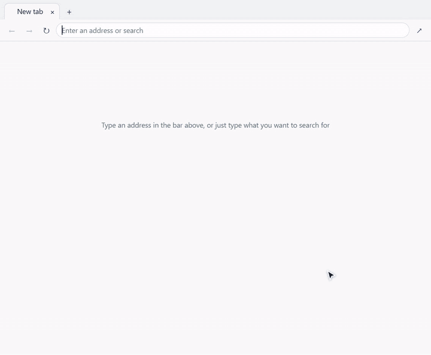

# workbench-browser

English | [中文](README.zh-CN.md)

A side-panel plugin for Google Antigravity: a real browser in the panel, shared by you and the agent. The agent reads the page structure to act, then reads the page back to check the result. You watch every step in the side panel and can take over at any time.



Unofficial community plugin, not affiliated with Google.

## Why it exists

A side-panel browser built on an `<iframe>` shows a blank page for any site that forbids embedding (`X-Frame-Options`, `frame-ancestors`), and most sites you need to log in to do. Working around that with a proxy that strips response headers is fragile and breaks logins.

This plugin does not embed pages. It runs a real headless Chrome and streams its picture into the panel, so every site behaves the way it does in a normal browser. The agent's browser tools are attached to that same browser, so what the agent clicks is what you see.

## What you get

- **A real browser.** Headless Chrome (Edge if Chrome is missing) with its own profile. Logins stay in that profile, separate from your everyday Chrome. No proxy, no header rewriting.
- **A panel you can use yourself.** Frames are drawn on a canvas: lossy while the page is moving, then one lossless frame when it settles, so text is sharp. Mouse, keyboard, IME text and clipboard go back to the browser. Native dropdowns, alert/confirm boxes and file pickers, which a headless browser cannot draw, are drawn by the panel.
- **One set of tabs for you and the agent.** The plugin ships an MCP entry that forwards to the chrome-devtools-mcp bundled with Antigravity, attached to the same browser. The agent takes a snapshot of the page, acts on elements by id, and takes another snapshot to verify.
- **A new-tab page.** The `+` button opens a blank page on which the panel lists frequently visited sites and recent pages. The data stays on your machine.
- **It cleans up after itself.** If nobody is watching and the agent has been idle for 30 minutes, the browser closes and starts again on next use. If the plugin backend is killed, the browser exits with it.
- **English and Chinese.** The panel and its messages are in English or Chinese, following the language Antigravity runs in; the command-line tools follow the system language. Websites get your system language, as in your everyday Chrome.

## Install

Requirements: Chrome or Edge, `node` on your PATH, and Antigravity 2.0 or the Antigravity CLI.

```
agy plugin install https://github.com/sevenshade-lab/workbench-browser
```

The plugin backend starts by itself and a panel named Workbench Browser appears in the side panel. If it does not, open Customizations → Installed, make sure `workbench-browser` is enabled, and check that its sidecar is enabled (see Sidecars in the Antigravity docs). The agent's browser tools are registered the first time the backend starts (it writes `mcp_config.json`); if the tools do not show up, restart Antigravity once.

**Upgrading.** Disable the plugin in Customizations → Installed, wait a few seconds for the backend to exit, then run the install command again. Installing over a running plugin makes `agy` clear the old folder and then fail because the folder is in use, leaving it empty. If that happens, disable the plugin, restart Antigravity and install again.

**From source** (also how you swap in a modified build):

```
node scripts/install.mjs            # dry run: prints what it would do
node scripts/install.mjs --apply    # replaces the files and restarts the plugin
```

## Using it

- **You:** open the panel, type an address, browse as usual. Log in to sites yourself; the agent never does that for you.
- **The agent:** the bundled skill tells it to use the plugin's browser tools (`list_pages`, `navigate_page`, `take_snapshot`, `click`, `fill`, `type_text`, `press_key`, `wait_for`, `take_screenshot`, `evaluate_script`), always in the order snapshot → act → snapshot. It can show you the panel by putting this link in a reply: `[Workbench Browser](sidecar://workbench-browser/panel/)`.
- **Status from a shell:** `node tools/wb.mjs status` lists open pages, `node tools/wb.mjs open <url>` opens one in the current tab.

## How it works

```
panel (sandboxed iframe)  <-- frames / mouse, keyboard -->  plugin backend  <-- debug pipe -->  headless Chrome
                                                                 ^                                   ^ debug port
                                              agent commands (status, open)        agent browser tools (chrome-devtools-mcp)
```

- **Panel to backend.** Antigravity does not let a panel connect to its backend directly. The panel page lives under `plugin://workbench-browser--panel-<port>`; its ordinary requests are forwarded by the Antigravity main process to an authenticated gateway and from there to the backend, but long-lived connections are not forwarded. So the panel first asks the backend for its real port and a key (`/api/link`), then connects to `ws://127.0.0.1:<port>` directly. When the direct connection is not possible (for example when you view Antigravity from another device), it falls back to plain requests: `/api/poll` for frames and messages, `/api/input` for mouse and keyboard. Which path was taken, and what blocked the other, is written to the backend log (lines starting with `[panel]`).
- **One backend at a time.** Restarting Antigravity does not always stop the previous backend. The old one keeps the browser profile locked, so a new browser would exit immediately. Two guards: a starting backend asks the registered old one to step down (`instances.json`, key required), and every backend watches Antigravity's language server and exits after losing it three times in a row.
- **History.** Visited pages are recorded in `history.json` in the plugin's data folder. Site icons are fetched once by the backend and cached.
- **Language.** The panel chooses between English and Chinese from `navigator.language` inside the panel, which is the language Antigravity itself runs in: Chinese for any `zh` locale, English for everything else. It tells the backend, so the backend's error messages come in the same language. Before any panel has connected (for example when the agent wakes the browser first), the backend and the command-line tools go by the system locale. Setting the environment variable `WORKBENCH_LANG` to `en` or `zh` overrides all of this. The browser is started without a language flag, so it follows the system like a normal Chrome; `WORKBENCH_BROWSER_LANG` (for example `ja` or `en-GB`) sets a different one.

## Privacy and security

- The browser has its own profile. Logins live only in the plugin's data folder and never touch your everyday Chrome profile.
- Browsing history for the new-tab page is kept only on your machine (`history.json`) and can be cleared from the new-tab page.
- The plugin itself reports nothing to anyone. Besides the pages you open, the only requests the backend makes are favicon fetches to the sites you visit.
- The browser honestly identifies itself as headless and automated. There is no fingerprint spoofing and no CAPTCHA bypassing. Logins and verification are yours to do, and whether a site accepts a headless browser varies.
- The direct panel connection requires a key that is generated randomly at every start. The backend's API for the panel only answers requests that come through Antigravity's gateway (tested: calling it directly from the same machine is refused with 401). The one exception is a small endpoint for the agent (wake the browser, report status, open an address); it requires its own key, which is stored in the plugin's data folder and readable only by your user account.
- **The debug port listens on localhost only, but any program on your machine can attach to this browser, including the accounts logged in inside it.** Do not log in to important accounts there on a machine that runs software you do not trust.

## Known limits

- **Only tested on Windows.** Browser paths for macOS and Linux are in the code but have not been exercised.
- **English and Chinese only.** Any other language gets the English UI. The backend log is in English.
- **It relies on a few Antigravity behaviors that are not documented**: the `sidecar.json` fields that declare the panel, the panel connecting directly to the backend after asking for its port, using the language server to tell whether Antigravity is still running, locating the bundled chrome-devtools-mcp in the install folder, and the backend writing `mcp_config.json` into the plugin folder. An Antigravity update may require changes here.
- **Logins and verification are manual.** Login pages and QR codes display fine in the panel, but some sites refuse headless browsers.
- The device scale factor is fixed when the browser starts. If the panel moves to a screen with a different scale, the picture is scaled until the next browser start. If the agent wakes the browser before any panel is open, the first panel to connect restarts it once at the panel's scale; tabs are restored by address and unsubmitted form content is lost.
- After `agy plugin disable`, Antigravity takes a few seconds to actually stop the backend. The install script waits for it; when doing it by hand, wait too.
- Downloads are not handled and not tested. File uploads work by typing a path. Native dropdowns inside cross-origin iframes are not drawn by the panel; use the arrow keys.
- IME: a hidden input in the panel receives the keyboard and sends the composed text to the page. Tested by typing Chinese through automation; how composing feels with a real IME (candidate window position and so on) varies by machine.
- Favicons are fetched by the backend directly, not through the browser's proxy settings. If that fails, a default icon is shown.

## Development

```
plugin.json                  plugin manifest
sidecars/panel/main.mjs      backend entry: pages, API, panel connection
sidecars/panel/lib/          browser, cdp (debug pipe), ws (panel connection),
                             helper-script (injected page helper), history, lang (UI language)
sidecars/panel/web/          panel UI; strings.js holds every UI string in both languages
mcp/launch.mjs               entry for the agent's browser tools
tools/wb.mjs                 agent commands: status / open
skills/workbench-browser/    usage notes for the agent
scripts/run-standalone.mjs   run the backend without Antigravity (development)
scripts/install.mjs          install from source (dry run unless --apply)
tests/                       see below
```

**Extensions.** On start the backend loads `sidecars/panel/extensions/<name>/index.mjs` if present. An extension exports `setup(context)`, can add API routes through `context.app` and read pages through `context.browser`, and returns scripts and styles for the panel to load. Panel scripts use `window.workbenchBrowser` to add buttons next to the address bar or a column beside the page. The interface is described in the extensions section of `main.mjs` and at the end of `web/app.js`. Private extensions can live under `private/plugin/` (git-ignored); `scripts/install.mjs` overlays them at install time.

**Tests.**

```
node tests/smoke.mjs       # whole chain: starts backend and browser, acts as the panel: click, type, paste, new tab, history
node tests/mcp.mjs         # agent path: wakes the browser through the MCP entry, reads, clicks, fills, reads back
node tests/lifecycle.mjs   # backend hand-over: new backend asks the old one to step down; backend exits when the language server is gone
```

All three use temporary folders and a local test page; they touch no real website. They talk to the backend directly, so **they do not cover Antigravity's forwarding layer**. After changing how the panel connects, install the plugin into Antigravity, open the panel once, and look for `[panel] connected` in the backend log. To force the fallback path in a preview window, append `&transport=poll` to the address; `&lang=en` or `&lang=zh` shows the panel in that language.

## License

MIT, see `LICENSE`.
