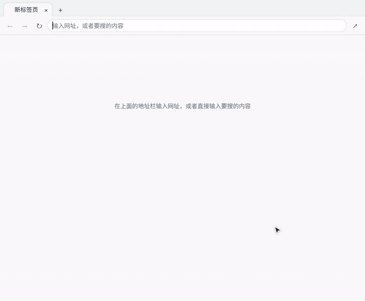

# 工作台浏览器（workbench-browser）

[English](README.md) | 中文

Google Antigravity 的侧边栏插件：面板里跑一个真浏览器，人和 agent 共用同一批页面。agent 读页面结构去操作，做完读回来核对；你在侧边栏里看着它每一步，随时可以自己接手。



非官方插件，和 Google 没有关系。

# 怎么做的

```
面板（沙箱 iframe）  ←—画面帧 / 鼠标键盘—→  插件后台  ←—调试管道—→  无界面 Chrome
                                               ↑                       ↑ 调试端口
                                     agent 的命令（状态、打开网址）   agent 的浏览器工具（chrome-devtools-mcp）
```

- **浏览器**：无界面 Chrome（没有就用 Edge），自己的资料目录，登录状态留在里面，和你平时用的 Chrome 分开。页面是它直接打开的，所以没有「禁止内嵌」这回事，不需要代理，也不改任何响应头。
- **面板**：后台把画面一帧帧送过来画在画布上（动的时候用有损帧，静下来补一张无损的，字是清楚的），鼠标、键盘、输入法上屏的字、复制粘贴原样送回去。原生下拉框、确认框、选文件框无界面浏览器画不出来，由面板代画。
- **新标签页**：点 + 开的是空白页，面板在上面画「常去」和「最近」，数据来自本机记下的去过的页（`history.json`，在插件的数据目录里，不往任何地方发，页面上可以清空）。站点图标由后台去取一次存下来。
- **面板怎么连后台**：Antigravity 不让面板直连后台。面板页面挂在 `plugin://workbench-browser--panel-<端口>` 下面，它发的普通请求由 Antigravity 主进程转给一层带鉴权的网关，网关再转到后台；长连接这条路不转。所以面板先用普通请求问到后台的真实端口和一把钥匙（`/api/link`），再直连 `ws://127.0.0.1:<端口>`。直连不上时（比如从别的设备远程看 Antigravity）退回到全用普通请求：`/api/poll` 取画面和消息、`/api/input` 送鼠标键盘。面板走了哪条路、被什么拦了，会记进后台日志（`[panel] …` 开头的行，日志是英文的）。
- **agent**：插件自带一个 MCP 入口，转发到 Antigravity 自带的 chrome-devtools-mcp，接在同一个浏览器的调试端口上。agent 读的、点的就是侧边栏里那几页。
- **语言**：界面有中文和英文。面板看 Antigravity 自己在用哪种语言（面板里的 `navigator.language`）：中文（含繁体）用中文，其余用英文；定下来以后告诉后台，后台给人看的报错跟着用同一种。还没有面板连上来的时候（比如 agent 先叫醒了浏览器），后台和 agent 用的小命令按系统语言来。环境变量 `WORKBENCH_LANG` 设成 `zh` 或 `en` 可以指定。浏览器本身启动时不指定语言，跟系统走，和平时的 Chrome 一样；想另指一种就设 `WORKBENCH_BROWSER_LANG`（比如 `ja`、`en-GB`）。

没人看、agent 也 30 分钟没动，浏览器自动关掉；下次打开面板或 agent 调工具时再起。插件后台被杀，浏览器跟着退（靠调试管道断开），不留孤儿进程。

**同一时间只留一个后台。** Antigravity 重启时不一定把上一个后台关掉（实测：语言服务没了，它起的 cmd 壳和后台还活着）。旧后台占着浏览器的资料目录，新后台起的浏览器发现目录被占会立刻退出，面板上就是「浏览器没能启动」。所以两头都防：新后台启动时请登记在册的旧后台让位（`instances.json`，认钥匙的才动）；每个后台自己也盯着 Antigravity 的语言服务，连上过之后又连续三次连不上就自己退。面板那头，浏览器没起来会自己再试几次。

# 安装

需要本机有 Chrome 或 Edge，以及 node（`node` 命令要在 PATH 里）。

```
agy plugin install https://github.com/sevenshade-lab/workbench-browser
```

装好后插件后台会自己起来，侧边栏里就有 Workbench Browser 这个面板；没有的话到 Antigravity 的 Customizations → Installed 里确认 `workbench-browser` 已启用，并确认它的后台（sidecar）是启用状态（见 Antigravity 文档的 Sidecars 一节）。agent 的浏览器工具入口由插件后台第一次启动时自己登记（写 `mcp_config.json`），工具没出现就重启一次 Antigravity。

**升级（已经装着旧版时）**：先在 Customizations → Installed 里把它停用，等几秒让后台退出，再跑上面的安装命令。插件开着的时候直接装，`agy` 会先清空旧目录、再因为目录被占用而失败，留下一个空目录；遇到了就停用插件、重启 Antigravity，再装一次。

从源码装（改了代码之后换版本也用它）：

```
node scripts/install.mjs            只说明会做什么，不动任何东西
node scripts/install.mjs --apply    换文件并重启插件
```

# 隐私和安全

- 浏览器用自己的资料目录，登录状态只留在插件的数据目录里，不碰你平时用的 Chrome。
- 去过的页只记在本机（`history.json`），不往任何地方发；新标签页上可以清空。
- 插件自己不联网上报任何东西。除了你打开的网页本身，唯一由后台发出的请求是去你访问过的站点取一次图标。
- 浏览器如实报自己是无界面、受程序控制的，没有做任何伪装，也不会去绕验证码。登录和验证只能人自己来；网站认不认因站而异。
- 面板和后台之间的直连要一把每次启动随机生成的钥匙；面板用的那些接口只认 Antigravity 网关转来的请求（实测：从本机直接去调会被拒绝，401）。例外是给 agent 留的一个小入口（叫醒浏览器、看状态、打开网址），它另凭一把钥匙，钥匙存在插件的数据目录里，只有本机当前用户读得到。
- **调试端口只开在本机，但本机上任何程序都能接进这个浏览器，包括里面登录着的账号。** 机器上有信不过的程序时，别在里面登录要紧的账号。

# 目录

```
plugin.json                  插件清单
sidecars/panel/main.mjs      后台入口：页面、接口、面板连接
sidecars/panel/lib/          browser（浏览器）、cdp（调试管道）、ws（面板连接）、
                             helper-script（注入页面的小帮手）、history（去过的页）、lang（界面语言）
sidecars/panel/web/          面板界面；strings.js 是面板上的字，中英文各一份
mcp/launch.mjs               agent 浏览器工具的入口
tools/wb.mjs                 agent 用的命令：status / open
skills/workbench-browser/    给 agent 看的使用说明
scripts/run-standalone.mjs   脱离 Antigravity 单独跑后台（开发用）
scripts/install.mjs          从源码装进 Antigravity（默认只预演，--apply 才动手）
tests/                       见下
```

# 附加功能

后台启动时会加载 `sidecars/panel/extensions/<名字>/index.mjs`（没有这个目录就是纯浏览器）。附加功能导出 `setup(context)`，可以用 `context.app` 加接口、用 `context.browser` 读页面，并返回要在面板里加载的脚本和样式；面板脚本通过 `window.workbenchBrowser` 往地址栏右边加按钮、往画面右边加一栏。接口说明在 `main.mjs` 的「附加功能」一节和 `web/app.js` 的末尾。

只在自己机器上用、不想公开的附加功能放在项目的 `private/plugin/` 下（已在 `.gitignore` 里），目录结构和插件根目录一样，`scripts/install.mjs` 安装时会叠上去。

# 测试

```
node tests/smoke.mjs       整条链路：真起后台和浏览器，扮成面板去点、打字、粘贴、开新标签页、看去过的页
node tests/mcp.mjs         agent 这条路：经 MCP 入口叫醒浏览器、读页面、点、填、读回
node tests/lifecycle.mjs   后台的进退：新后台请旧后台让位；语言服务没了后台自己退
```

三个都用临时目录和本机临时起的测试页，不碰任何真网站。

这些测试是直接连后台跑的，**测不到 Antigravity 中间那层转发**。改了面板和后台之间怎么连，一定要装进 Antigravity 实际开一次面板，再看后台日志里有没有 `[panel] connected`。在预览窗里想专门走后备路，地址后面加 `&transport=poll`；想看另一种语言的界面，加 `&lang=en` 或 `&lang=zh`。

# 已知的边界

- **只在 Windows 上跑过。** 代码里有 macOS、Linux 的浏览器路径，但没实测。
- **界面只有中文和英文两种**，其他语言的系统显示英文。后台日志和代码注释是英文的。
- **依赖了几处 Antigravity 文档里没写的行为**：`sidecar.json` 里声明面板的那几个字段、面板问到端口后直连后台、靠语言服务判断 Antigravity 还在不在、到安装目录里找自带的 chrome-devtools-mcp、后台自己往插件目录里写 `mcp_config.json`。Antigravity 升级后这几处可能要跟着改。
- **登录、验证只能人自己来。** 登录页和二维码在面板里能正常显示，但网站认不认一个无界面浏览器因站而异。
- 屏幕缩放比在浏览器启动时定死（原因见 `lib/browser.mjs` 里 `#applyViewport` 的说明）。面板换到缩放比不同的屏幕，画面会被缩放显示，下次浏览器启动时跟上。浏览器如果是 agent 先叫醒的（那时不知道缩放比），第一个面板连上来时会按面板的缩放比重开一次，标签页按地址恢复，页面里没提交的内容会丢。
- `agy plugin disable` 之后 Antigravity 要过几秒才真的停掉后台，安装脚本会等它退了再 `enable`；手动操作时也要等一下，否则后台还是旧的那个进程。
- 下载文件没做处理，也没测过。上传文件靠填路径。页面里嵌的跨站 iframe 中的原生下拉框没有代画，用键盘方向键可以选。
- 输入法：面板里有个隐形输入框接键盘，组字结束后把字送进页面。用自动化工具打中文测过，真人用拼音输入法组字的手感（候选词窗口的位置等）因机器而异。
- 取站点图标是后台直接发的请求，不走浏览器的代理设置；取不到就显示默认图标。

# 许可

MIT，见 `LICENSE`。
